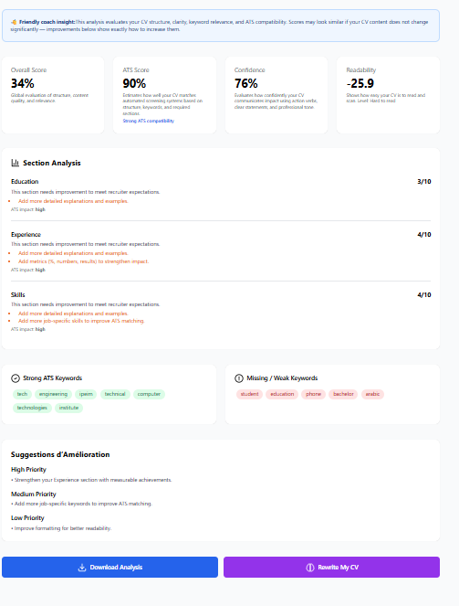
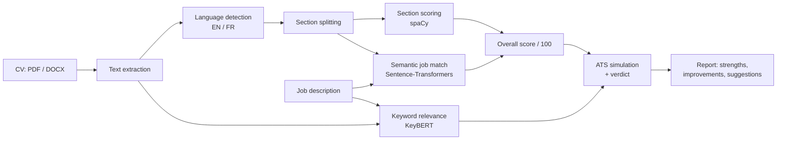
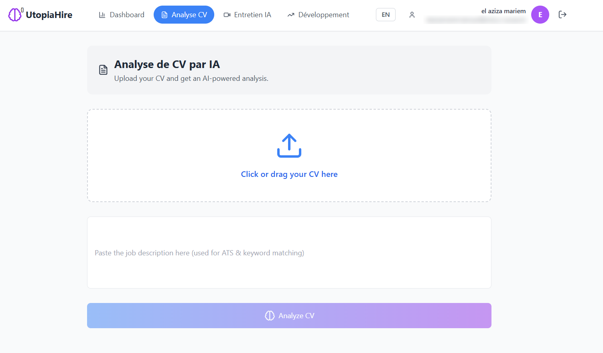
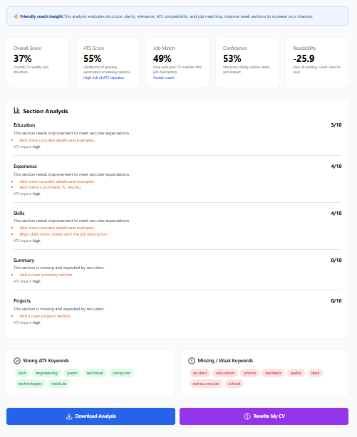
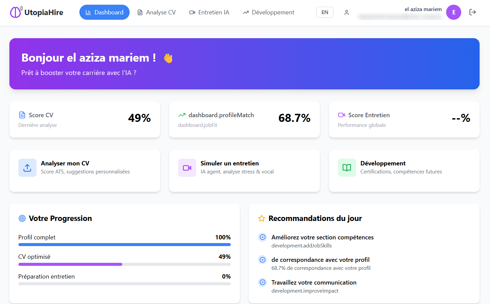
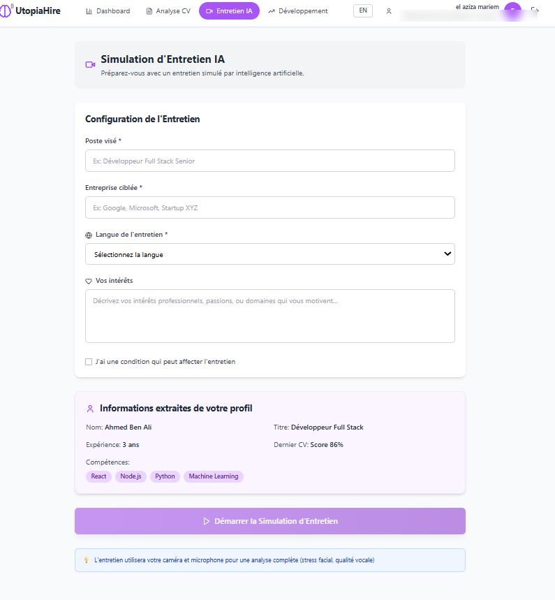
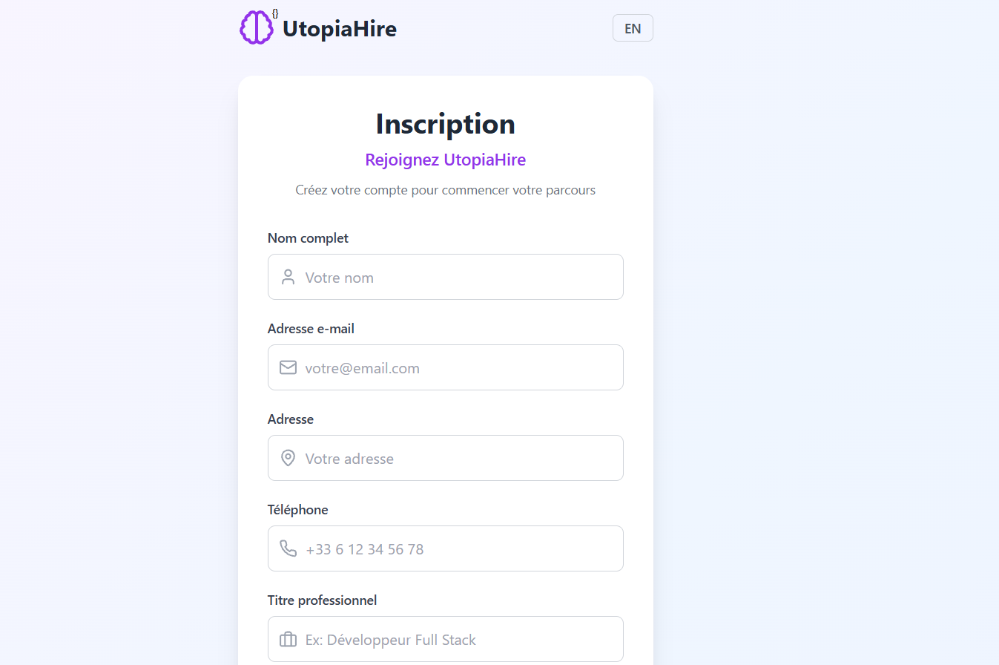
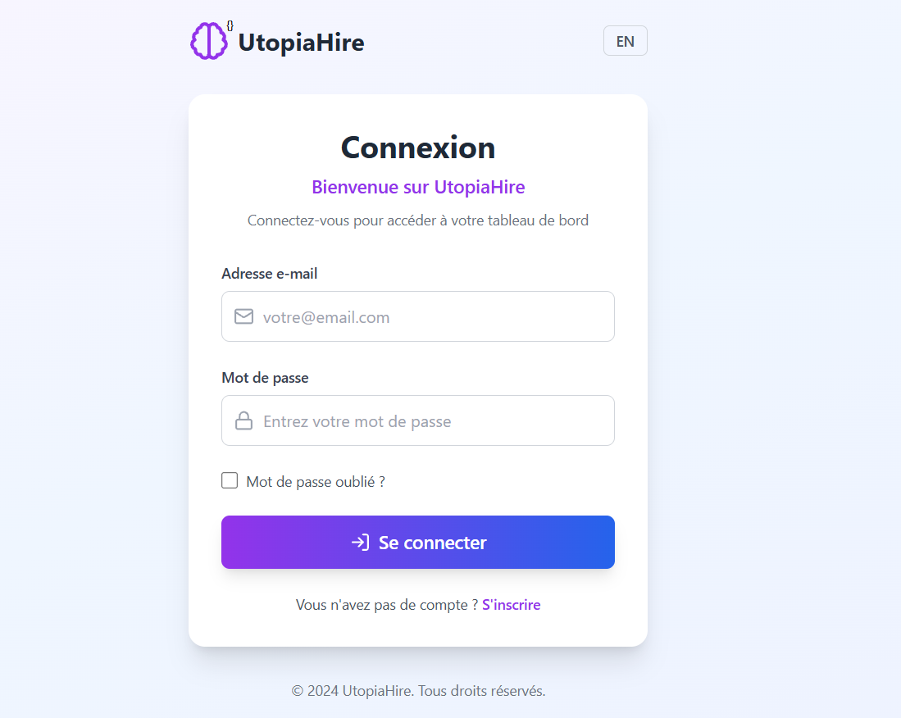
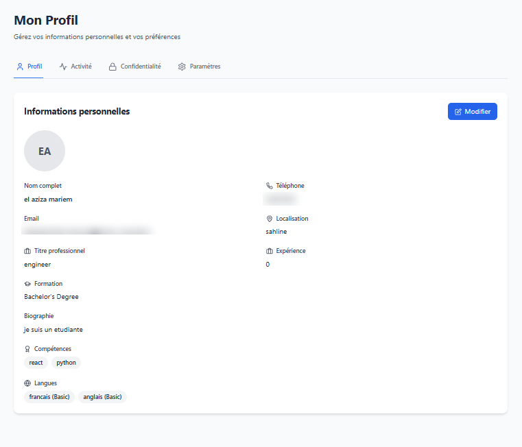

# UtopiaHire — AI-Powered CV Analysis & ATS Scoring

> Scores a CV against a specific job posting, simulates an ATS (Applicant Tracking System) filter, and tells the candidate what to fix. Includes a Llama 3.2 mock-interview module.



🎬 **Demo video:** [docs/demo.mp4](docs/demo.mp4) · 📄 **Project report (FR):** [docs/rapport-UtopiaHire.pdf](docs/rapport-UtopiaHire.pdf)

---

## The problem

Most CVs are filtered by software before a recruiter reads them, and candidates rarely know why theirs was rejected. UtopiaHire analyses a CV **for the position the candidate is applying to** and returns concrete, actionable feedback.

## Features

| | |
|---|---|
| **CV parsing** | Reads PDF and DOCX files (`pdfplumber`, `python-docx`) |
| **Bilingual** | Detects English or French and uses the matching spaCy model |
| **Section detection** | Finds summary, experience, education, skills, projects… and flags missing critical sections |
| **Section scoring** | Scores each section out of 10 (contact info, action verbs in experience, summary depth…) and computes a weighted overall score out of 100 |
| **Job matching** | Semantic similarity between the CV's skills and the job description (multilingual Sentence-Transformers) |
| **Keyword relevance** | Extracts keywords from both texts with KeyBERT and labels each CV keyword as a *strong* or *weak* match |
| **ATS simulation** | Penalises missing sections, low keyword coverage and weak structure, then gives a verdict: *likely to pass / may pass / high risk of rejection* |
| **Suggestions** | Improvement tips and relevant courses based on the weak keywords |
| **Readability** | Flesch reading ease for English, sentence-length estimate for French |
| **Mock interview** | Llama 3.2 (via Ollama) asks company, technical and behavioural questions and analyses each answer |

## How the CV analysis works



## Screenshots

| Upload a CV | Analysis result |
|---|---|
|  |  |

| Dashboard | Interview form |
|---|---|
|  |  |

| Sign up | Log in | Profile |
|---|---|---|
|  |  |  |

## Tech stack

- **NLP / AI:** spaCy (`en_core_web_sm`, `fr_core_news_sm`), Sentence-Transformers (`paraphrase-multilingual-MiniLM-L12-v2`), KeyBERT, langdetect, textstat
- **Mock interview:** Llama 3.2 via Ollama, FastAPI, Uvicorn
- **File parsing:** pdfplumber, python-docx

## Repository structure

```
├── src/
│   ├── analyzer.py        # CV analysis, scoring, keyword matching, ATS simulation
│   ├── file_reader.py     # PDF / DOCX text extraction
│   └── test_runner.py     # Command-line demo of the analyzer
├── llama3_2_module.py     # Mock interview in the terminal (Llama 3.2)
├── llama_service.py       # Mock interview as a FastAPI service
├── run_server.py          # Starts the interview API on port 5002
├── docs/                  # Screenshots, demo video, report
└── requirements.txt
```

## Run it

```bash
pip install -r requirements.txt
python -m spacy download en_core_web_sm
python -m spacy download fr_core_news_sm

# CV analysis (command line)
cd src
python test_runner.py

# Mock interview (requires Ollama with the llama3.2 model: `ollama pull llama3.2`)
python llama3_2_module.py      # in the terminal
python run_server.py           # or as an API on http://localhost:5002
```

## Team & my contribution

UtopiaHire is a semester project (2025–2026) at **ENISo — National Engineering School of Sousse**, built by **Chahd Zanina, Rania Akrout and El Aziza Mariem Lanouar**, supervised by Mr. Anis Ben Arbia and Mr. Anis Belhadj Brahim.

The full platform combines a React frontend with FastAPI micro-services: CV analysis, a Llama 3.2 interview generator, voice interaction (Whisper / VITS), audio analysis (Librosa) and facial-stress analysis (DeepFace).

**My part — the CV analysis & ATS module (`src/`):** NLP , text extraction, section detection and scoring, semantic matching to the target position, keyword relevance, the ATS filter simulation and the improvement suggestions. This repository also contains the Llama 3.2 question-generation service. The web interface and the other modules were built by my teammates and are not included here.
